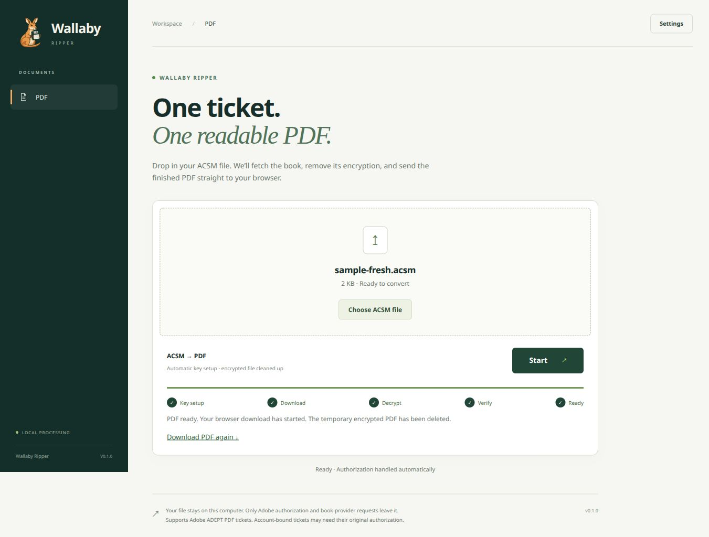

# Wallaby Ripper V1

An installable Ubuntu/Kubuntu application that opens a local browser interface.
Choose an Adobe ACSM PDF ticket, click Start, and receive an unencrypted PDF in
your browser. The PDF page is the only sidebar destination. Its dark green
sidebar follows Wallaby Wallet, with a new wallaby-and-floppy-disk icon.



## Stable release

**V1** is the first stable release (Debian package version **1.0.0**).
The default `stable` branch contains V1. The `Development` branch initially
points to exactly the same commit and has no additional changes.

[Download V1](https://github.com/bluesilent9/wallaby-ripper/releases/tag/V1)

## Install and run

Download `wallaby-ripper_1.0.0_all.deb`. On Ubuntu/Kubuntu 16.04 or later:

```sh
sudo apt install ./wallaby-ripper_1.0.0_all.deb
```

For Ubuntu 14.04, use the older package manager flow:

```sh
sudo dpkg -i wallaby-ripper_1.0.0_all.deb
sudo apt-get -f install
```

Then open **Wallaby Ripper** from the application menu, or run
`wallaby-ripper`. A current Firefox or Chromium-based browser is recommended.
A graphical session and an installed browser are needed for the browser UI.

The package installs the compiler and development libraries through Ubuntu's
package manager. On the first launch, the bundled, pinned processing tools
compile under your own user account, without root access or downloading source.
This normally takes less than a minute on a modern desktop; older computers
may take longer. The UI reports this preparation. Later launches reuse the
compiled tools. This approach avoids distributing a native binary that only
works with one Ubuntu release's OpenSSL or glibc.

For each conversion:

1. Choose or drop a `.acsm` file and click **Start**.
2. The progress display follows Key setup → Download → Decrypt → Verify → Ready.
3. The browser downloads the finished PDF. The download link allows a retry.

The progress bar represents processing stages, not a measured byte percentage.
The program handles one conversion at a time.

## Automatic keys

No manual key entry is required for a fresh, compatible ticket. Wallaby Ripper
uses its saved authorization, copies a valid authorization from libgourou or
the Calibre ACSM plugin when available, or creates an anonymous Adobe ADEPT
authorization automatically. It retains the resulting device and license keys
for subsequent conversions. It does not require Adobe Digital Editions or
Calibre to be installed.

Existing authorization locations checked:

- `$ADEPT_DIR`, when set
- `$XDG_CONFIG_HOME/adept` (normally `~/.config/adept`)
- `~/.adept`
- `~/.config/calibre/plugins/DeACSM/account`
- `~/.config/calibre/plugins/ACSMInput/account`

A ticket already redeemed with another account can be locked to that original
authorization. Open **Settings** to sign in to its Adobe account or import
`device.xml`, `activation.xml`, and `devicesalt` together. Switching to an
unrelated new key cannot decrypt an account-bound book. Previous authorizations
are retained as local backups when you change accounts. Adobe passwords pass
to the activation tool over stdin and are not stored in settings, process
arguments, or application logs.

The implementation uses libgourou 0.9's `acsmdownloader` and `adept_remove`.
A second DRM-removal product is unnecessary because libgourou supplies both
steps. Support is limited to compatible Adobe ADEPT PDFs. EPUB tickets,
password-only PDFs, other DRM systems, expired tickets and unsupported Adobe
DRM variants are not converted. Provider availability and acceptance of
anonymous authorization are outside the application's control.

## Files, privacy and cleanup

The web server binds only to `127.0.0.1`, using a random session URL, host
validation and a protected write API. All CSS, scripts and artwork are local.
Only Adobe authorization and the book provider's fulfillment/download requests
leave the computer; there is no upload to a Wallaby server.

- The temporary encrypted PDF and uploaded ticket copy are deleted immediately
  after the decrypted PDF passes the `pdfinfo` encryption check.
- Failed conversions delete their temporary job folder.
- The decrypted working copy is kept for up to one hour for download retries,
  then removed by periodic cleanup while the app is running. The browser's own
  downloaded copy remains wherever the browser saves it.
- Interrupted-session job folders are removed on the next launch.
- Authorization keys are retained deliberately, separately from job files.
- Upload limit: 2 MiB. Each processing output file is limited to 1 GiB. Network
  operations and helper processes have timeouts.

Default private folders:

```text
~/.config/wallaby-ripper/adept/       Saved authorization
~/.config/wallaby-ripper/authorization-backup-*/  Previous authorizations
~/.cache/wallaby-ripper/             Compiled tools and temporary jobs
~/.cache/wallaby-ripper/build.log    Native compilation diagnostics
```

Standard XDG configuration/cache overrides are respected. Do not delete the
saved authorization if you may need to re-download books bound to it.

For diagnostics, `wallaby-ripper --no-browser` prints the local session URL.
Press Ctrl+C to stop that foreground instance. Reopening the launcher while
an instance is running reopens its browser page.

## Release compatibility

The package is `Architecture: all` and compiles against each machine's native
libraries. The release target list below reflects official support on
24 November 2026. Ubuntu Pro and Legacy coverage depends on the machine's
subscription and enabled repositories; this app does not enable those services.

| Distribution | Release targets |
| --- | --- |
| Ubuntu standard maintenance | 22.04 LTS, 24.04 LTS, 26.04 LTS, 26.10 |
| Ubuntu Pro / ESM | 18.04 LTS, 20.04 LTS |
| Ubuntu Pro Legacy add-on | 14.04 LTS, 16.04 LTS |
| Kubuntu project support | 24.04 LTS, 26.04 LTS, 26.10 |

Ubuntu's longer base-system maintenance should not be confused with extended
support for older Kubuntu KDE desktops. See [Ubuntu's lifecycle](https://ubuntu.com/about/release-cycle),
[Ubuntu ESM](https://ubuntu.com/security/esm), [Kubuntu downloads](https://kubuntu.org/download/)
and [Kubuntu 26.10 release notes](https://kubuntu.org/news/kubuntu-26-10-release-notes/).

See `VALIDATION.md` for the tested release matrix, native PDF checks, browser
checks, and remaining limits. The release tests use amd64 Ubuntu userspaces;
other architectures and full KDE desktop installations have not been tested.

## Source and rebuild

The source archive includes the complete application, pinned upstream source,
local compatibility changes, artwork and tests. No Python package installation
or pip dependencies are needed.

```sh
# Build a DEB from the source directory; requires dpkg-deb.
sh scripts/build-deb.sh /path/to/output

# Run the application from source after installing its DEB dependencies.
python3 -m wallaby_ripper.server

# Run application tests. Uses a real pdfinfo parser and simulated tool boundaries.
PYTHONDONTWRITEBYTECODE=1 python3 -m unittest discover -s tests -v
```

Original application code: MIT. Bundled libgourou/uPDFParser: LGPL-3.0-or-later,
utilities: BSD-3-Clause, pugixml: MIT. See `THIRD-PARTY.txt` and `vendor/UPSTREAM.txt`.
